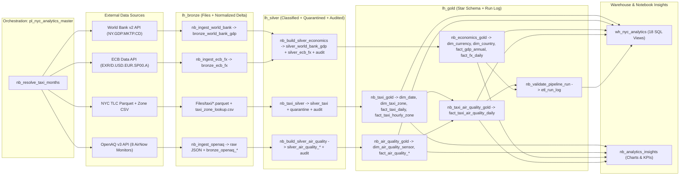

# NYC Urban Mobility, Air Quality & Macroeconomic Analytics

This Microsoft Fabric project connects three datasets that rarely sit in the same warehouse: New York City Yellow Taxi trips, hourly PM2.5 readings from OpenAQ v3 air-quality monitors, and macroeconomic series from the European Central Bank and the World Bank. Over a five-month window (`2025-11` through `2026-03`), the pipeline explores how urban ridership moves alongside daily and hourly particulate matter, how daily taxi revenue translates between USD and EUR across market holidays, and how recent U.S. and Eurozone GDP sits as long-run context behind short-term city data.

Working across these sources together exposes real data-engineering problems that isolated toy datasets skip. Yellow Taxi Parquet files contain 3.4 to 4.3 million trips per month, mixed with DST clock anomalies, zero-distance rides, negative Flex Fare adjustments, and stray out-of-month timestamps. Street-level air-quality data comes from sparse monitoring stations with sensor dropouts and maintenance flags, and ECB exchange rates pause on weekends and holidays while taxis run every day. Rather than smoothing these quirks away before loading, the pipeline preserves source accountability from Bronze through Gold and exposes both metrics and quality flags downstream.

---

## How the Pipeline Works

One master Fabric pipeline (`pl_nyc_analytics_master`) coordinates the entire flow around a single month selection resolved at startup by `nb_resolve_taxi_months`. Downstream notebooks ingest only the requested months, isolate anomalies into Silver quarantine tables without dropping records, rebuild month-scoped Gold star-schema facts, and run cross-layer reconciliation before writing run status to `etl_run_log`.



---

## Key Engineering & Analytical Choices

Every monthly Silver and Gold table writes through Delta `replaceWhere` bounded to the active months (for example `local_date >= month_start AND local_date < month_end` or integer `date_key` ranges). Single-month backfills and nonconsecutive re-runs therefore leave unrelated history untouched and avoid duplicate rows.

Source records are never silently dropped. Trips with invalid timelines (such as dropoffs recorded before pickups during DST fall-back) or out-of-month timestamps go to quarantine tables rather than failing quietly or corrupting adjacent months. Valid edge cases stay in Silver with explicit boolean flags, and every Bronze-to-Silver and Silver-to-Gold boundary verifies zero unexplained row-count drift. Across the five-month baseline, that accounts for thousands of long-distance, long-duration, and clock-skew records that typical pre-filters discard.

Taxi financial reporting keeps gross and net accounting separate. Negative `fare_amount` and `total_amount` entries appear legitimately in TLC files due to disputes, voids, and Flex Fare (`payment_type = 0`) adjustments, with a notable spike in `2025-11`. Gold facts publish both gross nonnegative totals and signed net totals side by side alongside counts by `payment_type`. Zero-distance rides likewise stay `0.0` inside `avg_distance_miles`, paired with `avg_positive_distance_miles` for comparison.

For air quality and foreign exchange, the models prefer explicit gaps and provenance over silent interpolation. The air-quality layer reads eight validated AirNow reference monitors rather than mixing uncalibrated sensors or coercing missing flag metadata to unflagged. Daily citywide PM2.5 requires at least 4 sensors meeting 75% valid hourly coverage (on DST-aware 23-, 24-, or 25-hour local days), leaving days below threshold as `NULL` instead of `0`. Because ECB does not publish `EUR/USD` rates on weekends or TARGET holidays, `fact_fx_daily` uses a 14-day Bronze lookback window to carry forward the most recent business-day rate while storing `rate_observation_date` and `is_carry_forward_rate` for auditing.

---

## What the Data Shows and Current Limitations

Across November 2025 through March 2026 (`151` calendar days, `132` of which meet the daily air-quality coverage threshold after mid-to-late November sensor gaps), the charts in [nb_analytics_insights](nb_analytics_insights.Notebook/notebook-content.py) highlight practical relationships alongside clear analytical limits.

Day-to-day NYC taxi volume and citywide PM2.5 show virtually no linear correlation (`Pearson r = 0.035` across `132` reliable days), indicating that factors outside Yellow Taxi ridership drive most of the daily variance. Hourly profiles are more informative than daily totals, contrasting a steady daytime climb in taxi trips (peaking around `18:00`) against a bimodal PM2.5 curve (a morning peak around `07:00`, a midday dip near `13:00`, and an evening peak between `20:00` and `21:00`).

Coverage also bounds what can be claimed from the external reference data. Eight fixed AirNow monitors capture a network-level PM2.5 signal rather than neighborhood-level air quality across all 260+ TLC taxi zones, so `fact_taxi_hourly_zone` supports temporal and spatial demand analysis without implying zone-level pollution causality. Likewise, World Bank annual GDP provides multi-year U.S. versus Eurozone backdrop rather than an explanatory driver for a five-month operational window.

On the serving side, Power BI semantic models and live dashboards have not been built yet. Visual analysis currently runs inside [nb_analytics_insights](nb_analytics_insights.Notebook/notebook-content.py), while [wh_nyc_analytics](wh_nyc_analytics.Warehouse/wh_nyc_analytics.sqlproj) already exposes all 18 dimension, fact, and audit views over T-SQL for BI tools when needed.

Column-level schemas and grain definitions are documented in [Data Dictionary & Source-to-Target Lineage](docs/data_dictionary_and_lineage.md), and data-quality rules are detailed in [Governance, Data Quality Rules & Analytical Assumptions](docs/governance_and_quality_rules.md).

---

## Project Structure

| Component | Purpose | Location |
| --- | --- | --- |
| Master Pipeline | Resolves months, runs parallel ingestion, Silver, Gold, and final checks | [pl_nyc_analytics_master](pl_nyc_analytics_master.DataPipeline/pipeline-content.json) |
| Taxi Ingestion Pipeline | Downloads monthly NYC TLC Parquet files into Bronze with retries | [pl_ingest_taxi](pl_ingest_taxi.DataPipeline/pipeline-content.json) |
| Month Resolver | Validates `MONTHS_JSON` or discovers existing Bronze Parquet months | [nb_resolve_taxi_months](nb_resolve_taxi_months.Notebook/notebook-content.py) |
| OpenAQ Ingestion | Fetches OpenAQ v3 sensor metadata, hourly readings, and flags | [nb_ingest_openaq](nb_ingest_openaq.Notebook/notebook-content.py) |
| World Bank & ECB Ingestion | Fetches `NY.GDP.MKTP.CD` annual GDP and daily ECB `USD/EUR` FX | [nb_ingest_world_bank](nb_ingest_world_bank.Notebook/notebook-content.py), [nb_ingest_ecb_fx](nb_ingest_ecb_fx.Notebook/notebook-content.py) |
| Silver Layer Notebooks | Schema enforcement, flag classification, quarantine routing, and audit tables | [nb_taxi_silver](nb_taxi_silver.Notebook/notebook-content.py), [nb_build_silver_air_quality](nb_build_silver_air_quality.Notebook/notebook-content.py), [nb_build_silver_economics](nb_build_silver_economics.Notebook/notebook-content.py) |
| Gold Layer Notebooks | Star-schema dimensions, daily/hourly facts, FX carry-forward, combined daily fact | [nb_taxi_gold](nb_taxi_gold.Notebook/notebook-content.py), [nb_air_quality_gold](nb_air_quality_gold.Notebook/notebook-content.py), [nb_economics_gold](nb_economics_gold.Notebook/notebook-content.py), [nb_taxi_air_quality_gold](nb_taxi_air_quality_gold.Notebook/notebook-content.py) |
| Run Validation & Logging | Cross-layer reconciliation writing status rows to `lh_gold.dbo.etl_run_log` | [nb_validate_pipeline_run](nb_validate_pipeline_run.Notebook/notebook-content.py) |
| Analytical Notebook | Generates five visualization panels answering the core project questions | [nb_analytics_insights](nb_analytics_insights.Notebook/notebook-content.py) |
| Fabric Warehouse | SQL database project exposing 18 star-schema and audit views | [wh_nyc_analytics](wh_nyc_analytics.Warehouse/wh_nyc_analytics.sqlproj) |
| Technical Documentation | Schema contracts, lineage, data-quality policies, and operational notes | [Data Dictionary](docs/data_dictionary_and_lineage.md), [Governance & Quality Rules](docs/governance_and_quality_rules.md) |

---

## Running in Microsoft Fabric

1. Store the OpenAQ API token in `lh_bronze/Files/_secrets/openaq.json` (or configure Azure Key Vault settings as described in [Governance & Quality Rules](docs/governance_and_quality_rules.md#4-operations-secrets-and-monitoring)).
2. Trigger `pl_nyc_analytics_master` in one of two mutually exclusive month modes (`nb_resolve_taxi_months` fails fast when both `months` and `discover_months: true` are supplied):

   To ingest and process an explicit list of months:

   ```json
   {
     "months": ["2025-11", "2025-12", "2026-01", "2026-02", "2026-03"],
     "discover_months": false,
     "ingest_taxi": true,
     "ingest_openaq": true,
     "ingest_economics": true
   }
   ```

   To reprocess every valid Yellow Taxi Parquet month already in `lh_bronze/Files/taxi` without re-downloading TLC files (set `ingest_taxi` to `false` explicitly, since its pipeline default is `true`):

   ```json
   {
     "months": [],
     "discover_months": true,
     "ingest_taxi": false,
     "ingest_openaq": true,
     "ingest_economics": true
   }
   ```

3. Once Gold validation finishes, run [nb_analytics_insights](nb_analytics_insights.Notebook/notebook-content.py) interactively with `MONTHS_JSON = "[]"` to visualize all available months, or supply a JSON array to inspect a subset.
