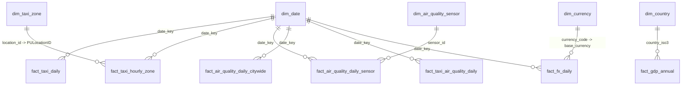

# Power BI Semantic Model & Reporting Blueprint

## 1. Star-Schema Relationships (`wh_nyc_analytics`)

All relationships use **single-direction (`1:*`)** filtering from conformed dimensions to facts, with **zero direct fact-to-fact relationships**.



*(Note: `dim_currency` may also join `dim_country[primary_currency_code]` as an inactive or snowflake reference if needed, while `fact_fx_daily` uses `base_currency = 'EUR'`.)*

---

## 2. Core DAX Measures

### Mobility Measures
```dax
Total Recorded Trips = SUM(fact_taxi_daily[trip_count])

Revenue Eligible Trips = SUM(fact_taxi_daily[revenue_trip_count])

Gross Nonnegative Revenue (USD) = SUM(fact_taxi_daily[total_amount_usd])

Gross Nonnegative Fare (USD) = SUM(fact_taxi_daily[total_fare_usd])

Signed Net Revenue (USD) = SUM(fact_taxi_daily[net_total_amount_usd])

Signed Net Fare (USD) = SUM(fact_taxi_daily[net_fare_usd])

Zero-Distance Trips = SUM(fact_taxi_daily[zero_distance_trips])

Zero-Distance Trip % =
DIVIDE([Zero-Distance Trips], [Total Recorded Trips], 0)

Avg Reported Distance (mi) =
DIVIDE(
    SUMX(
        fact_taxi_daily,
        (fact_taxi_daily[trip_count] - fact_taxi_daily[missing_distance_trips] - fact_taxi_daily[negative_distance_trips])
            * fact_taxi_daily[avg_distance_miles]
    ),
    SUMX(
        fact_taxi_daily,
        fact_taxi_daily[trip_count] - fact_taxi_daily[missing_distance_trips] - fact_taxi_daily[negative_distance_trips]
    )
)

Negative Amount Trips = SUM(fact_taxi_daily[negative_amount_trips])
Missing Amount Trips = SUM(fact_taxi_daily[missing_amount_trips])
```

### Air Quality Measures
```dax
Network Mean PM2.5 (ug/m3) = AVERAGE(fact_air_quality_daily_citywide[network_mean_pm25])

Network Median PM2.5 (ug/m3) = AVERAGE(fact_air_quality_daily_citywide[network_median_pm25])

Days With Reliable PM2.5 Estimate =
CALCULATE(
    COUNTROWS(fact_air_quality_daily_citywide),
    NOT ISBLANK(fact_air_quality_daily_citywide[network_mean_pm25])
)

Sensor Valid Hour Coverage % =
DIVIDE(
    SUM(fact_air_quality_daily_sensor[valid_hour_count]),
    SUM(fact_air_quality_daily_sensor[expected_hour_count]),
    0
)
```

### Economic Measures (USD & EUR Conversion)
```dax
Daily EUR per USD Rate = AVERAGE(fact_fx_daily[eur_per_usd_rate])

Daily USD per EUR Rate = AVERAGE(fact_fx_daily[usd_per_eur_rate])

Gross Nonnegative Revenue (EUR) =
SUMX(
    vw_taxi_revenue_usd_eur_daily,
    vw_taxi_revenue_usd_eur_daily[total_amount_eur]
)

Signed Net Revenue (EUR) =
SUMX(
    vw_taxi_revenue_usd_eur_daily,
    vw_taxi_revenue_usd_eur_daily[net_total_amount_eur]
)

Annual GDP (USD Trillions) =
DIVIDE(SUM(fact_gdp_annual[gdp_usd]), 1000000000000)
```

### Data Quality Audit Measures
```dax
Taxi Bronze Rows = SUM(vw_audit_taxi_quality[bronze_row_count])
Taxi Quarantined Rows = SUM(vw_audit_taxi_quality[quarantine_total_count])
Taxi Reconciliation Diff = SUM(vw_audit_taxi_quality[reconciliation_diff])
Taxi Legacy Filter Would-Drop % =
DIVIDE(SUM(vw_audit_taxi_quality[legacy_filter_excluded_count]), [Taxi Bronze Rows], 0)

OpenAQ In-Scope Hours = SUM(vw_audit_air_quality[in_scope_bronze_count])
OpenAQ Quarantined Hours = SUM(vw_audit_air_quality[quarantined_count])
OpenAQ Unknown Flag Hours = SUM(vw_audit_air_quality[unknown_flag_status_count])
```

---

## 3. Five Power BI Reports

| Report Page | Primary Fact / View | Required Visuals & Slicers |
| --- | --- | --- |
| **1. Mobility** | `fact_taxi_daily`, `fact_taxi_hourly_zone`, `dim_taxi_zone`, `dim_date` | KPI cards (`Total Recorded Trips`, `Gross Nonnegative Revenue (USD)`, `Signed Net Revenue (USD)`, `Avg Reported Distance`, `Zero-Distance Trip %`); daily trip & revenue trend; borough/zone bar chart; `pickup_hour` × `day_name` demand heatmap; zero-distance drilldown table. |
| **2. Air Quality** | `fact_air_quality_daily_citywide`, `fact_air_quality_daily_sensor`, `dim_air_quality_sensor`, `dim_date` | KPI cards (`Network Mean PM2.5`, `Days With Reliable PM2.5 Estimate`, `Sensor Valid Hour Coverage %`); daily PM2.5 line chart with min/max sensor band; sensor completeness matrix; quarantined/flagged hours by sensor. Explicit subtitle: *"Selected 8-monitor AirNow network estimate (≥75% coverage, ≥4 sensors)."* |
| **3. Mobility vs Air Quality** | `fact_taxi_air_quality_daily`, `fact_taxi_hourly_zone`, `dim_date` | Dual-axis daily trips vs. `network_mean_pm25` time series; scatter plot (daily `trip_count` vs. `network_mean_pm25`, colored by weekend/weekday); peak-hour demand profile alongside air-quality days. Includes explicit disclaimer that 8 monitors do not support zone-level PM2.5 causality. |
| **4. Economic** | `vw_taxi_revenue_usd_eur_daily`, `fact_fx_daily`, `fact_gdp_annual`, `dim_country`, `dim_currency` | Daily USD vs. EUR taxi revenue comparison; ECB `USD per 1 EUR` rate trend highlighting carry-forward weekend/holiday dates (`is_carry_forward_rate`); annual `fact_gdp_annual` comparison (`USA` vs. `EMU`). |
| **5. Data Quality** | `vw_audit_taxi_quality`, `vw_audit_air_quality`, `vw_audit_economics`, `vw_etl_run_log` | Reconciliation status cards (`diff = 0` check across all sources); monthly Taxi quarantine & anomaly breakdown (`dropoff_before_pickup`, `out_of_month`, negative amounts by context, >100 mi, >8h); OpenAQ quarantine & multi-reason flags; `vw_etl_run_log` latest run table. |

---

## 4. Publishing Steps in Fabric

1. Create Warehouse `wh_nyc_analytics` in the Fabric workspace and execute [wh_nyc_analytics_star_schema.sql](../sql/wh_nyc_analytics_star_schema.sql).
2. In `wh_nyc_analytics`, open **Reporting** → **New semantic model**, select all dimension, fact, and audit views, and configure the `1:*` relationships above.
3. Add the DAX measures and build the 5 report pages in Power BI (DirectLake / DirectQuery on `wh_nyc_analytics`).
4. To share publicly if tenant admin enables **Publish to web**: **File → Embed report → Publish to web (public)**; otherwise **Export → PDF** and add screenshots to `README.md`.
